# JARKOM-ETS

## Member

| Nama | NRP | Peran & Pembagian Kerja |
|---|---|---|
| Yovi Prayudya Rizky Ramadhani | 5027251107 | **A - Topologi dan subnetting**: topologi CPT, VLSM/CIDR, tabel revisi, penamaan, label, dan IP dasar. Menjelaskan video bagian 0-2. |
| Askhabul | 5027251049 | **B - Routing dan keamanan**: static routing, NAT, GRE, OSPF, link L7, dan failover. Menjelaskan video bagian 3, 5, 6, dan 7. |
| Keisya | 5027251068 | **C - DHCP dan layanan**: DHCP PC/CCTV serta DNS, web, FTP, dan email. Menjelaskan video bagian 4, 8, dan 9. |

README, laporan, bukti, dan persiapan video dikerjakan bersama. Tiap anggota menulis dan mengecek bagian yang menjadi tugasnya.

## Daftar Isi

- [1. Topologi](#1-topologi)
  - [Topologi akhir](#topologi-akhir)
  - [R-ISP](#r-isp)
  - [R-PUSAT](#r-pusat)
  - [Command Center / DC](#command-center--dc)
  - [Barat](#barat)
  - [Timur](#timur)
  - [Selatan](#selatan)
  - [Utara](#utara)
  - [Pelabuhan](#pelabuhan)
  - [Desain tiap lokasi](#desain-tiap-lokasi)
  - [Alasan pemilihan perangkat dan media](#alasan-pemilihan-perangkat-dan-media)
  - [Penambahan port pada R-PUSAT](#penambahan-port-pada-r-pusat)
  - [Pemetaan port](#pemetaan-port)
- [2. Tabel VLSM, CIDR, dan Revisi](#2-tabel-vlsm-cidr-dan-revisi)
- [3. Static Routing](#3-static-routing)
  - [3.1 Aturan static routing](#31-aturan-static-routing)
  - [3.2 Tabel konfigurasi static route](#32-tabel-konfigurasi-static-route)
  - [3.3 Uji konektivitas antar-LAN](#33-uji-konektivitas-antar-lan)
- [4. IP dan DHCP](#4-ip-dan-dhcp)
  - [4.1 IP statis](#41-ip-statis)
    - [Alamat interface router](#alamat-interface-router)
    - [Alamat server](#alamat-server)
    - [Cek koneksi](#cek-koneksi)
  - [4.2 DHCP LAN](#42-dhcp-lan)
  - [4.3 Cek DHCP](#43-cek-dhcp)
- [5. Network Address Translation (NAT)](#5-network-address-translation-nat)
  - [5.1 Aturan NAT Overload (PAT)](#51-aturan-nat-overload-pat)
  - [5.2 Konfigurasi NAT pada R-PUSAT](#52-konfigurasi-nat-pada-r-pusat)
  - [5.3 Hasil pengujian](#53-hasil-pengujian)
    - [Tabel rute Router-ISP](#1-tabel-rute-router-isp-bebas-dari-rute-privat)
    - [Uji ping ke Server 8.8.8.8](#2-uji-ping-dari-seluruh-subnet-ke-server-publik-8888)
    - [Tabel translasi NAT](#3-bukti-translasi-alamat-nat-table-translation)
- [6. Tunnel GRE](#6-tunnel-gre)
  - [6.1 Alamat Tunnel0](#61-alamat-tunnel0)
  - [6.2 Konfigurasi Tunnel GRE](#62-konfigurasi-tunnel-gre)
    - [R-PUSAT](#1-konfigurasi-pada-r-pusat)
    - [R-PELABUHAN](#2-konfigurasi-pada-r-pelabuhan)
  - [6.3 Uji traceroute](#63-uji-traceroute)
  - [6.4 Catatan GRE](#64-catatan-gre)
- [7. OSPF dan Failover](#7-ospf-dan-failover)
  - [7.1 Berkas OSPF](#71-berkas-ospf)
  - [7.2 Link cadangan L7](#72-link-cadangan-l7-r-dc-ke-r-utara)
  - [7.3 OSPF Area 0](#73-ospf-area-0)
    - [Passive interface](#1-passive-interface)
    - [Default route OSPF](#2-default-route-ospf)
    - [Konfigurasi tiap router](#3-konfigurasi-tiap-router)
  - [7.4 Hasil OSPF](#74-hasil-ospf)
    - [Neighbor R-DC](#1-neighbor-r-dc)
    - [Default route di router cabang](#2-default-route-di-router-cabang)
  - [7.5 Uji failover](#75-uji-failover)
    - [L1 aktif](#1-l1-aktif)
    - [L1 dimatikan](#2-l1-dimatikan)
    - [Hasil saat L1 mati](#3-hasil-saat-l1-mati)
    - [L1 diaktifkan lagi](#4-l1-diaktifkan-lagi)
- [8. Layanan Server](#8-layanan-server)
  - [8.1 DNS dan HTTP](#81-srv-balaikota---dns-dan-http)
  - [8.2 DHCP CCTV, FTP, dan Email](#82-srv-storage-dc---dhcp-cctv-ftp-dan-email)
  - [8.3 Hasil uji CIDR dan OSPF](#83-hasil-uji-cidr-dan-ospf)
    - [K08_CIDR.pkt](#pengujian-pada-k08_cidrpkt)
    - [K08_CIDR_OSPF.pkt](#pengujian-pada-k08_cidr_ospfpkt)
- [Checklist akhir](#checklist-akhir)

## 1. Topologi


Topologi acuan dari soal:


### Topologi akhir

**CIDR**

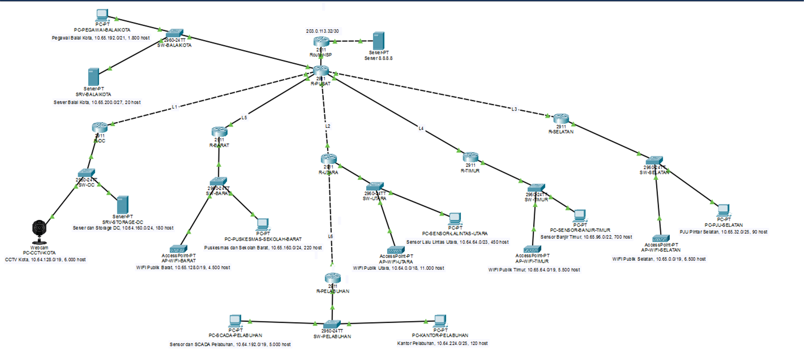

**OSPF**

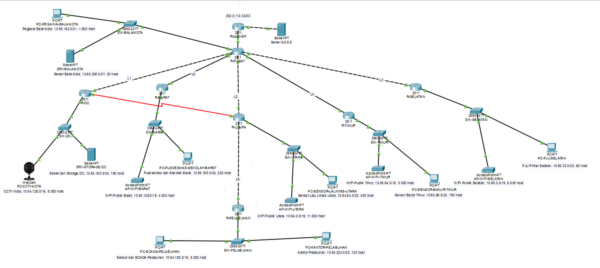

CIDR dipakai sebagai desain utama. Pembagian bloknya ada di sheet `Revisi CIDR`,
sedangkan tabel VLSM dipakai sebagai pembanding jawaban UTS.

### R-ISP


Router diberi nama `R-ISP` lewat `hostname`, lalu tiap interface diberi alamat IP beserta subnet mask-nya dan diaktifkan dengan `no shutdown`:
 
- `Gi0/0` dengan `203.0.113.34/30` ke R-PUSAT.
- `Gi0/1` dengan `8.8.8.1/24` ke Server 8.8.8.8, yang menjadi gateway server tersebut.
R-ISP tidak diberi route ke alamat privat internal.

### R-PUSAT


Konfigurasi R-PUSAT terdiri dari tiga bagian:
 
1. **Interface routed**: `Gi0/0` (`203.0.113.33/30`) ke R-ISP dan `Gi0/1` (`10.65.208.5/30`) ke R-UTARA.
2. **Sub-interface untuk SW-BALAIKOTA**: `Gi0/2.10` (`10.65.192.1/21`, Pegawai Balai Kota) dan `Gi0/2.20` (`10.65.200.1/27`, Server Balai Kota), masing-masing dengan `encapsulation dot1Q` sesuai nomor VLAN.
3. **Link L2 sampai L5 lewat modul HWIC-4ESW**: tiap port dijadikan access port di VLAN 12 sampai 15, lalu alamat link /30 dipasang di `interface vlan 12` sampai `interface vlan 15`.


**R-SELATAN**


**R-TIMUR**


**R-BARAT**


**R-UTARA**


**R-PELABUHAN**


R-DC


Setelah IP dan subnet mask pada seluruh router selesai, SW-BALAIKOTA dikonfigurasi agar perangkat LAN dapat memakai R-PUSAT sebagai gateway.


Output `show interfaces trunk` awalnya belum menampilkan trunk. Konfigurasi port kemudian diperbaiki seperti pada gambar berikut.


Konfigurasi SRV-BALAIKOTA:


Alamat yang digunakan:
- IPv4 Address: 10.65.200.2
- Subnet Mask: 255.255.255.224
- Default Gateway: 10.65.200.1

Pengujian ping awal:


Letak kesalahan:


Port Fa0/1 belum menjadi trunk. Konfigurasinya diperbaiki dengan perintah berikut:

```
SW-BALAIKOTA(config)#interface fa0/1
SW-BALAIKOTA(config-if)# switchport mode trunk

SW-BALAIKOTA(config-if)#interface fa0/2
SW-BALAIKOTA(config-if)# switchport mode access
SW-BALAIKOTA(config-if)# switchport access vlan 10
SW-BALAIKOTA(config-if)#interface fa0/3
SW-BALAIKOTA(config-if)# switchport mode access
SW-BALAIKOTA(config-if)# switchport access vlan 20
```

Setelah port diperbaiki, ping berhasil.


### Command Center / DC


```
configure terminal
no ip domain-lookup
vlan 10
 name CCTV
vlan 20
 name SERVER
interface fa0/3
 switchport mode trunk
interface fa0/1
 switchport mode access
 switchport access vlan 10
interface fa0/2
 switchport mode access
 switchport access vlan 20
end
write memory
```

Fa0/1 dan Fa0/2 ditempatkan pada VLAN yang berbeda agar CCTV dan server tidak masuk ke segmen yang salah.


IP address, subnet mask, dan gateway SRV-STORAGE-DC:


### Barat

Konfigurasi router dan switch:


### Timur


Fa0/3 sempat salah dikonfigurasi. Perbaikannya:

```
configure terminal
interface fa0/2
 switchport mode access
 switchport access vlan 10
interface fa0/3
 switchport mode access
 switchport access vlan 20
end
write memory
```

### Selatan


Alamat uji yang benar adalah `10.65.208.9`, bukan `10.65.208.13`.


### Utara


### Pelabuhan


Hasil pemeriksaan trunk dan VLAN:

```
SW-PELABUHAN#show interface trunk
Port        Mode         Encapsulation  Status        Native vlan
Fa0/1       on           802.1q         trunking      1

Port        Vlans allowed on trunk
Fa0/1       1-1005

Port        Vlans allowed and active in management domain
Fa0/1       1,10,20

Port        Vlans in spanning tree forwarding state and not pruned
Fa0/1       1,10,20
```

```
SW-PELABUHAN#show vlan brief

VLAN Name                             Status    Ports
---- -------------------------------- --------- -------------------------------
1    default                          active    Fa0/4, Fa0/5, Fa0/6, Fa0/7
                                                Fa0/8, Fa0/9, Fa0/10, Fa0/11
                                                Fa0/12, Fa0/13, Fa0/14, Fa0/15
                                                Fa0/16, Fa0/17, Fa0/18, Fa0/19
                                                Fa0/20, Fa0/21, Fa0/22, Fa0/23
                                                Fa0/24, Gig0/1, Gig0/2
10   SCADA                            active    Fa0/2
20   KANTOR                           active    Fa0/3
1002 fddi-default                     active    
1003 token-ring-default               active    
1004 fddinet-default                  active    
1005 trnet-default                    active  
```

Tampilan topologi setelah perbaikan awal:


### Desain tiap lokasi
 
Hubungan antar-router (L1 sampai L6, R-ISP, dan Server 8.8.8.8) mengikuti Gambar 1 tanpa perubahan. Kabel antar-router memakai Copper Cross-Over, sedangkan router ke switch dan switch ke perangkat memakai Copper Straight-Through. Tunnel GRE R-PUSAT ke R-PELABUHAN (Soal 6) bukan kabel fisik, jadi tidak digambar sebagai kabel. Jalur fisik R-PELABUHAN tetap lewat R-UTARA (L6).
 
Setiap lokasi punya dua LAN, sedangkan router 2911 hanya punya tiga port Gigabit. Karena itu semua lokasi dirancang dengan pola yang sama:
 
- **Satu router 2911** sebagai gateway.
- **Satu switch 2960-24TT** di bawah router. Satu kabel dari router ke switch membawa dua VLAN (trunk): VLAN 10 untuk LAN pertama dan VLAN 20 untuk LAN kedua. Switch 2960 dipilih dibanding Switch-PT karena VLAN dan trunk bisa dikonfigurasi lewat CLI.
- **Router-on-a-stick**: router memakai dua sub-interface (`.10` dan `.20`) dengan `encapsulation dot1Q`, sehingga satu port router cukup untuk dua subnet dan port lainnya tersisa untuk link backbone.
- **Satu perangkat perwakilan per LAN**, sesuai ketentuan soal.

| Lokasi | Router | Switch | LAN 1 (VLAN 10) | LAN 2 (VLAN 20) |
|---|---|---|---|---|
| Balai Kota | R-PUSAT | SW-BALAIKOTA | PC-PEGAWAI-BALAIKOTA (PC) | SRV-BALAIKOTA (server) |
| Command Center | R-DC | SW-DC | PC-CCTV-KOTA (webcam) | SRV-STORAGE-DC (server) |
| Utara | R-UTARA | SW-UTARA | AP-WIFI-UTARA (access point) | PC-SENSOR-LALINTAS-UTARA (PC) |
| Pelabuhan | R-PELABUHAN | SW-PELABUHAN | PC-SCADA-PELABUHAN (PC) | PC-KANTOR-PELABUHAN (PC) |
| Selatan | R-SELATAN | SW-SELATAN | AP-WIFI-SELATAN (access point) | PC-PJU-SELATAN (PC) |
| Timur | R-TIMUR | SW-TIMUR | AP-WIFI-TIMUR (access point) | PC-SENSOR-BANJIR-TIMUR (PC) |
| Barat | R-BARAT | SW-BARAT | AP-WIFI-BARAT (access point) | PC-PUSKESMAS-SEKOLAH-BARAT (PC) |
 
### Alasan pemilihan perangkat dan media
 
- **WiFi Publik** memakai access point karena pengguna terhubung secara nirkabel. Access point tersambung ke switch dengan kabel UTP.
- **Server** (Balai Kota dan Storage DC) memakai Server-PT karena nanti menjalankan layanan (DNS, web, FTP, email pada Soal 8) dan memakai IP statis.
- **CCTV** memakai webcam karena fungsinya perangkat penangkap gambar.
- **Sensor, PJU, kantor, dan pegawai** diwakili PC, karena cukup untuk menguji konektivitas dan mendapat IP dinamis.
- **Kabel UTP** dipilih untuk semua link karena jaraknya pendek dan biayanya lebih rendah. Di lapangan, link antar-lokasi (L1 sampai L6) lebih sesuai memakai fiber, tetapi di Packet Tracer tetap digambar dengan kabel tembaga.
### Penambahan port pada R-PUSAT
 
R-PUSAT butuh tujuh koneksi (R-ISP, L1 sampai L5, dan SW-BALAIKOTA), sedangkan 2911 hanya punya tiga port Gigabit bawaan. Karena itu ditambahkan satu modul **HWIC-4ESW** (empat port) pada slot HWIC 0.
 
Modul Ethernet routed berbasis tembaga tidak ada di daftar modul versi Packet Tracer yang dipakai, jadi port modul ini berupa port switch. Tiap port dimasukkan ke VLAN tersendiri, dan alamat link dipasang di interface VLAN-nya.
 
| Port R-PUSAT | Terhubung ke | Link | Interface |
|---|---|---|---|
| Gi0/0 | R-ISP | - | 203.0.113.33/30 |
| Gi0/1 | R-UTARA | L2 | 10.65.208.5/30 |
| Gi0/2 | SW-BALAIKOTA | - | sub-interface `.10` dan `.20` |
| Fa0/0/0 | R-BARAT | L5 | VLAN 15, 10.65.208.17/30 |
| Fa0/0/1 | R-DC | L1 | VLAN 12, 10.65.208.1/30 |
| Fa0/0/2 | R-SELATAN | L3 | VLAN 13, 10.65.208.9/30 |
| Fa0/0/3 | R-TIMUR | L4 | VLAN 14, 10.65.208.13/30 |
 
### Pemetaan port
 
Nomor port tidak seragam di semua lokasi, jadi dicatat di sini sesuai kabel yang terpasang.
 
| Router | Port ke router lain | Port ke switch |
|---|---|---|
| R-ISP | Gi0/0 ke R-PUSAT | Gi0/1 ke Server 8.8.8.8 |
| R-DC | Gi0/0 ke R-PUSAT (L1) | Gi0/1 ke SW-DC |
| R-UTARA | Gi0/0 ke R-PUSAT (L2), Gi0/2 ke R-PELABUHAN (L6) | Gi0/1 ke SW-UTARA |
| R-PELABUHAN | Gi0/0 ke R-UTARA (L6) | Gi0/1 ke SW-PELABUHAN |
| R-SELATAN | Gi0/0 ke R-PUSAT (L3) | Gi0/1 ke SW-SELATAN |
| R-TIMUR | Gi0/0 ke R-PUSAT (L4) | Gi0/1 ke SW-TIMUR |
| R-BARAT | Gi0/1 ke R-PUSAT (L5) | Gi0/0 ke SW-BARAT |
 
Port uplink (trunk) ke router tiap switch: SW-BALAIKOTA `Fa0/3`, SW-DC `Fa0/3`, dan SW-UTARA, SW-PELABUHAN, SW-SELATAN, SW-TIMUR, SW-BARAT di `Fa0/1`. Port lain adalah access port ke VLAN 10 dan VLAN 20.
 
## 2. Tabel VLSM, CIDR, dan Revisi


Tabel lengkap ada di spreadsheet berikut. Kolom alasan revisi menjelaskan perbedaan dengan jawaban UTS.

[Revisi Tabel Jarkom ETS.xlsx](./Revisi%20Tabel%20Jarkom%20ETS.xlsx)

## 3. Static Routing

### 3.1 Aturan static routing
Aturan static routing yang dipakai:
1. **Default Route Arah Keluar (Upstream)**:
   - Default route (`0.0.0.0/0`) hanya diperbolehkan mengarah ke router di atasnya.
   - Router cabang stub (R-DC, R-SELATAN, R-TIMUR, R-BARAT) hanya mengarahkan default route ke gateway R-PUSAT.
   - R-PELABUHAN mengarahkan default route ke R-UTARA (`10.65.208.21`).
   - R-UTARA mengarahkan default route ke R-PUSAT (`10.65.208.5`).
   - R-PUSAT mengarahkan default route ke R-ISP (`203.0.113.34`).
2. **Static Route Arah Dalam (Downstream)**:
   - R-PUSAT wajib memiliki static route spesifik ke seluruh LAN milik router di bawahnya (R-DC, R-UTARA, R-PELABUHAN, R-SELATAN, R-TIMUR, dan R-BARAT).
   - R-UTARA wajib memiliki static route spesifik ke seluruh LAN milik R-PELABUHAN (`10.64.192.0/19` dan `10.64.224.0/25`).

### 3.2 Tabel Konfigurasi Static Route

| Router | Network Tujuan | Netmask | Next-Hop | Keterangan |
|---|---|---|---|---|
| **R-PUSAT** | `0.0.0.0` | `0.0.0.0` | `203.0.113.34` | Default route keluar ke R-ISP |
| | `10.64.128.0` | `255.255.224.0` | `10.65.208.2` | CCTV Kota (R-DC) |
| | `10.64.160.0` | `255.255.255.0` | `10.65.208.2` | Server & Storage DC (R-DC) |
| | `10.64.0.0` | `255.255.192.0` | `10.65.208.6` | WiFi Publik Utara (R-UTARA) |
| | `10.64.64.0` | `255.255.254.0` | `10.65.208.6` | Sensor Lalu Lintas (R-UTARA) |
| | `10.65.208.20` | `255.255.255.252` | `10.65.208.6` | Interkoneksi L6 (R-UTARA <-> R-PELABUHAN) |
| | `10.64.192.0` | `255.255.224.0` | `192.168.8.2` | SCADA Pelabuhan melalui Tunnel0 |
| | `10.64.224.0` | `255.255.255.128` | `192.168.8.2` | Kantor Pelabuhan melalui Tunnel0 |
| | `10.65.0.0` | `255.255.224.0` | `10.65.208.10` | WiFi Publik Selatan (R-SELATAN) |
| | `10.65.32.0` | `255.255.255.128` | `10.65.208.10` | PJU Pintar Selatan (R-SELATAN) |
| | `10.65.64.0` | `255.255.224.0` | `10.65.208.14` | WiFi Publik Timur (R-TIMUR) |
| | `10.65.96.0` | `255.255.252.0` | `10.65.208.14` | Sensor Banjir Timur (R-TIMUR) |
| | `10.65.128.0` | `255.255.224.0` | `10.65.208.18` | WiFi Publik Barat (R-BARAT) |
| | `10.65.160.0` | `255.255.255.0` | `10.65.208.18` | Puskesmas & Sekolah (R-BARAT) |
| **R-DC** | `0.0.0.0` | `0.0.0.0` | `10.65.208.1` | Default route upstream ke R-PUSAT |
| **R-UTARA** | `0.0.0.0` | `0.0.0.0` | `10.65.208.5` | Default route upstream ke R-PUSAT |
| | `10.64.192.0` | `255.255.224.0` | `10.65.208.22` | Sensor & SCADA (R-PELABUHAN) |
| | `10.64.224.0` | `255.255.255.128` | `10.65.208.22` | Kantor Pelabuhan (R-PELABUHAN) |
| **R-PELABUHAN** | `0.0.0.0` | `0.0.0.0` | `10.65.208.21` | Default route upstream ke R-UTARA |
| **R-SELATAN** | `0.0.0.0` | `0.0.0.0` | `10.65.208.9` | Default route upstream ke R-PUSAT |
| **R-TIMUR** | `0.0.0.0` | `0.0.0.0` | `10.65.208.13` | Default route upstream ke R-PUSAT |
| **R-BARAT** | `0.0.0.0` | `0.0.0.0` | `10.65.208.17` | Default route upstream ke R-PUSAT |

### 3.3 Uji konektivitas antar-LAN
- **PC-PEGAWAI-BALAIKOTA** (`10.65.192.3`) -> **SRV-STORAGE-DC** (`10.64.160.2`): Sukses (*Packet Loss 0%*).
- **PC-PEGAWAI-BALAIKOTA** (`10.65.192.3`) -> **PC-KANTOR-PELABUHAN** (`10.64.224.3`): Sukses (*Packet Loss 0%*).
- **SRV-STORAGE-DC** (`10.64.160.2`) -> **PC-PUSKESMAS-SEKOLAH-BARAT** (`10.65.160.3`): Sukses (*Packet Loss 0%*).
- **PC-PJU-SELATAN** (`10.65.32.3`) -> **PC-SENSOR-BANJIR-TIMUR** (`10.65.96.3`): Sukses (*Packet Loss 0%*).


---

## 4. IP dan DHCP


### 4.1 IP statis
 
Semua interface router pakai IP statis via CLI. Server diset dari **Desktop, IP Configuration**. PC dan webcam dapat IP dari DHCP. AP-PT hanya menjadi bridge Layer 2.
 
#### Alamat interface router
 
| Router | Interface | Alamat | Tujuan |
|---|---|---|---|
| R-ISP | Gi0/0 | 203.0.113.34/30 | R-PUSAT |
| | Gi0/1 | 8.8.8.1/24 | Server 8.8.8.8 |
| R-PUSAT | Gi0/0 | 203.0.113.33/30 | R-ISP |
| | Gi0/1 | 10.65.208.5/30 | L2 |
| | Gi0/2.10 | 10.65.192.1/21 | Pegawai Balai Kota |
| | Gi0/2.20 | 10.65.200.1/27 | Server Balai Kota |
| | Vlan12 | 10.65.208.1/30 | L1 |
| | Vlan13 | 10.65.208.9/30 | L3 |
| | Vlan14 | 10.65.208.13/30 | L4 |
| | Vlan15 | 10.65.208.17/30 | L5 |
| R-DC | Gi0/0 | 10.65.208.2/30 | L1 |
| | Gi0/1.10 | 10.64.128.1/19 | CCTV Kota |
| | Gi0/1.20 | 10.64.160.1/24 | Server dan Storage DC |
| R-UTARA | Gi0/0 | 10.65.208.6/30 | L2 |
| | Gi0/1.10 | 10.64.0.1/18 | WiFi Publik Utara |
| | Gi0/1.20 | 10.64.64.1/23 | Sensor Lalu Lintas Utara |
| | Gi0/2 | 10.65.208.21/30 | L6 |
| R-PELABUHAN | Gi0/0 | 10.65.208.22/30 | L6 |
| | Gi0/1.10 | 10.64.192.1/19 | Sensor dan SCADA |
| | Gi0/1.20 | 10.64.224.1/25 | Kantor Pelabuhan |
| R-SELATAN | Gi0/0 | 10.65.208.10/30 | L3 |
| | Gi0/1.10 | 10.65.0.1/19 | WiFi Publik Selatan |
| | Gi0/1.20 | 10.65.32.1/25 | PJU Pintar Selatan |
| R-TIMUR | Gi0/0 | 10.65.208.14/30 | L4 |
| | Gi0/1.10 | 10.65.64.1/19 | WiFi Publik Timur |
| | Gi0/1.20 | 10.65.96.1/22 | Sensor Banjir Timur |
| R-BARAT | Gi0/1 | 10.65.208.18/30 | L5 |
| | Gi0/0.10 | 10.65.128.1/19 | WiFi Publik Barat |
| | Gi0/0.20 | 10.65.160.1/24 | Puskesmas dan Sekolah Barat |
 
#### Alamat server
 
| Server | Alamat | Mask | Gateway |
|---|---|---|---|
| Server 8.8.8.8 | 8.8.8.8 | 255.255.255.0 | 8.8.8.1 |
| SRV-BALAIKOTA | 10.65.200.2 | 255.255.255.224 | 10.65.200.1 |
| SRV-STORAGE-DC | 10.64.160.2 | 255.255.255.0 | 10.64.160.1 |
 
Alamat `.2` dipakai untuk server, tepat setelah gateway `.1`. Jadi rentang DHCP pengguna di subnet yang sama harus dimulai setelah alamat tersebut supaya tidak bentrok.
 
#### Cek koneksi
 
- R-UTARA dan R-PUSAT saling ping berhasil (5/5), jadi L2 aktif.
- R-PELABUHAN ke R-UTARA berhasil (5/5), jadi L6 aktif.
- R-DC, R-BARAT, R-TIMUR, dan R-SELATAN masing-masing berhasil ping ke R-PUSAT.
- R-ISP ke Server 8.8.8.8 berhasil. Balasan pertama biasanya hilang karena proses ARP.
Ping dari LAN di balik router ke jaringan lain (misalnya server DC ke R-PUSAT) belum berhasil pada tahap ini karena static route belum dipasang. Itu bagian Soal 3.


### 4.2 DHCP LAN

DHCP dijalankan di router gateway masing-masing LAN. Gateway `.1` dan server `.2` dikeluarkan dari pool biar tidak bentrok. Semua pool memakai DNS `10.65.200.2`.

| LAN pengguna | Network | Gateway | Lease perangkat uji |
|---|---|---|---|
| Pegawai Balai Kota | `10.65.192.0/21` | `10.65.192.1` | `10.65.192.3` |
| Sensor Lalu Lintas Utara | `10.64.64.0/23` | `10.64.64.1` | `10.64.64.3` |
| SCADA Pelabuhan | `10.64.192.0/19` | `10.64.192.1` | `10.64.192.3` |
| Kantor Pelabuhan | `10.64.224.0/25` | `10.64.224.1` | `10.64.224.3` |
| PJU Pintar Selatan | `10.65.32.0/25` | `10.65.32.1` | `10.65.32.3` |
| Sensor Banjir Timur | `10.65.96.0/22` | `10.65.96.1` | `10.65.96.3` |
| Puskesmas/Sekolah Barat | `10.65.160.0/24` | `10.65.160.1` | `10.65.160.3` |

Khusus **CCTV Kota**, DHCP dipusatkan pada `SRV-STORAGE-DC` (`10.64.160.2`) dengan pool `10.64.128.0/19`. Karena server berada di subnet berbeda, sub-interface `R-DC Gi0/1.10` memakai `ip helper-address 10.64.160.2`. Webcam memperoleh `10.64.128.3/19`, gateway `10.64.128.1`, dan DNS `10.65.200.2` pada interface kabel `GigabitEthernet3`.

### 4.3 Cek DHCP

- Semua PC mendapat IP, mask, gateway, dan DNS sesuai pool.
- PJU Selatan telah dikoreksi menjadi mask `/25` (`255.255.255.128`), bukan `/20`.
- Ping PJU Selatan (`10.65.32.3`) ke Sensor Banjir Timur (`10.65.96.3`) berhasil dengan **0% packet loss**.
- Bukti pengujian CIDR tersimpan di `assets/bukti/CIDR`.

---

## 5. Network Address Translation (NAT)

### 5.1 Aturan NAT Overload (PAT)
Aturannya:
1. Semua host internal dapat mengakses Server `8.8.8.8` lewat IP publik R-PUSAT (`203.0.113.33`).
2. Router ISP (`Router-ISP`) **dilarang keras** memiliki rute ke alamat IP privat internal (`10.64.0.0/15`). ISP hanya mengenal jaringan publik (`203.0.113.32/30` dan `8.8.8.0/24`).

NAT Overload (PAT) dipasang pada R-PUSAT.

### 5.2 Konfigurasi NAT pada R-PUSAT
1. Membuat Standard Access List (`access-list 1`) untuk mencakup seluruh blok IP privat kelompok 8 (`10.64.0.0/15`):
   ```cisco
   access-list 1 permit 10.64.0.0 0.1.255.255
   ```
2. Menentukan interface luar (*outside*) ke ISP:
   ```cisco
   interface GigabitEthernet0/0
    ip nat outside
   ```
3. Menentukan interface dalam (*inside*) ke jaringan internal:
   ```cisco
   interface GigabitEthernet0/1
    ip nat inside
   interface GigabitEthernet0/2.10
    ip nat inside
   interface GigabitEthernet0/2.20
    ip nat inside
   interface Vlan12
    ip nat inside
   interface Vlan13
    ip nat inside
   interface Vlan14
    ip nat inside
   interface Vlan15
    ip nat inside
   ```
4. Mengaktifkan translasi NAT Overload menggunakan IP interface publik `GigabitEthernet0/0`:
   ```cisco
   ip nat inside source list 1 interface GigabitEthernet0/0 overload
   ```

### 5.3 Hasil pengujian
#### 1. Tabel Rute Router-ISP (Bebas dari Rute Privat)
Tabel rute `Router-ISP` tidak memuat rute privat:
```cisco
Router-ISP#show ip route
Codes: L - local, C - connected, S - static, R - RIP, M - mobile, B - BGP
       D - EIGRP, EX - EIGRP external, O - OSPF, IA - OSPF inter area
       ...
Gateway of last resort is not set

     8.0.0.0/24 is subnetted, 1 subnets
C       8.8.8.0 is directly connected, GigabitEthernet0/1
L       8.8.8.1/32 is directly connected, GigabitEthernet0/1
     203.0.113.32/30 is subnetted, 1 subnets
C       203.0.113.32 is directly connected, GigabitEthernet0/0
L       203.0.113.34/32 is directly connected, GigabitEthernet0/0
```
Router-ISP hanya mengenal jaringan publik dan link ke R-PUSAT.

#### 2. Uji Ping dari Seluruh Subnet ke Server Publik 8.8.8.8
- `PC-PEGAWAI-BALAIKOTA` (`10.65.192.3`) -> `ping 8.8.8.8`: **Success (Loss 0%)**
- `SRV-STORAGE-DC` (`10.64.160.2`) -> `ping 8.8.8.8`: **Success (Loss 0%)**
- `PC-KANTOR-PELABUHAN` (`10.64.224.3`) -> `ping 8.8.8.8`: **Success (Loss 0%)**
- `PC-PUSKESMAS-SEKOLAH-BARAT` (`10.65.160.3`) -> `ping 8.8.8.8`: **Success (Loss 0%)**

#### 3. Bukti Translasi Alamat (NAT Table Translation)
Pengecekan translasi aktif pada R-PUSAT saat host internal melakukan ping/akses ke internet:
```cisco
R-PUSAT#show ip nat translations
Pro  Inside global     Inside local       Outside local      Outside global
icmp 203.0.113.33:1     10.65.192.3:1      8.8.8.8:1          8.8.8.8:1
icmp 203.0.113.33:2     10.64.160.2:2      8.8.8.8:2          8.8.8.8:2
icmp 203.0.113.33:3     10.64.224.3:3      8.8.8.8:3          8.8.8.8:3
```
Semua IP privat ditranslasikan ke `203.0.113.33` dengan nomor port yang berbeda.


Tabel Router-ISP hanya berisi jaringan `8.8.8.0/24` dan `203.0.113.32/30`. Setelah rute privat dihapus, ping dari PC Balai Kota ke `8.8.8.8` tetap berhasil 4/4.


Konfigurasi NAT outside, NAT inside, dan perintah overload pada R-PUSAT:


---

## 6. Tunnel GRE

### 6.1 Alamat Tunnel0
Ketentuan Soal 6 mengharuskan:
1. Membangun tunnel GRE point-to-point antara **R-PUSAT** dan **R-PELABUHAN**.
2. Alokasi IP Tunnel: Subnet `192.168.K.0/30` -> untuk Kelompok 8 adalah `192.168.8.0/30`:
   - R-PUSAT: `192.168.8.1/30`
   - R-PELABUHAN: `192.168.8.2/30`
3. Seluruh lalu lintas data antara subnet **Balai Kota** (`10.65.192.0/21`, `10.65.200.0/27`) dan subnet **Pelabuhan** (`10.64.192.0/19`, `10.64.224.0/25`) wajib melewati tunnel ini, melompati router perantara (R-UTARA).

### 6.2 Konfigurasi Tunnel GRE
#### 1. Konfigurasi pada R-PUSAT
```cisco
interface Tunnel0
 ip address 192.168.8.1 255.255.255.252
 tunnel source GigabitEthernet0/1
 tunnel destination 10.65.208.22
 exit

! Pengalihan rute subnet Pelabuhan agar melalui jalur tunnel
ip route 10.64.192.0 255.255.224.0 192.168.8.2
ip route 10.64.224.0 255.255.255.128 192.168.8.2
```

#### 2. Konfigurasi pada R-PELABUHAN
```cisco
interface Tunnel0
 ip address 192.168.8.2 255.255.255.252
 tunnel source GigabitEthernet0/0
 tunnel destination 10.65.208.5
 exit

! Pengalihan rute subnet Balai Kota agar melalui jalur tunnel
ip route 10.65.192.0 255.255.248.0 192.168.8.1
ip route 10.65.200.0 255.255.255.224 192.168.8.1
```

### 6.3 Uji traceroute
Hasil pengujian `tracert` dari `PC-PEGAWAI-BALAIKOTA` (`10.65.192.3`) menuju `PC-KANTOR-PELABUHAN` (`10.64.224.3`):
```text
PC>tracert 10.64.224.3
Tracing route to 10.64.224.3 over a maximum of 30 hops: 

  1   0 ms      0 ms      0 ms      10.65.192.1
  2   0 ms      0 ms      0 ms      192.168.8.2
  3   0 ms      0 ms      0 ms      10.64.224.3

Trace complete.
```
Hop `192.168.8.2` menunjukkan trafik masuk ke Tunnel0 dan keluar di
R-PELABUHAN. R-UTARA tidak terlihat sebagai hop untuk paket di dalam tunnel.

Status `Tunnel0` pada R-PUSAT juga sudah `up/up` dengan alamat `192.168.8.1/30`:


### 6.4 Catatan GRE

Rute ke subnet Pelabuhan diarahkan ke `192.168.8.2`, jadi router memilih
Tunnel0 daripada default route. GRE hanya membungkus paket dan tidak
mengenkripsi isinya. Jika dibutuhkan enkripsi, tunnel GRE dapat dipasangkan
dengan IPsec.

---

## 7. OSPF dan Failover

### 7.1 Berkas OSPF

Pengujian OSPF memakai file [`K08_CIDR_OSPF.pkt`](./project/K08_CIDR_OSPF.pkt). Static route antar-router
diganti dengan OSPFv2 area 0.

### 7.2 Link cadangan L7 R-DC ke R-UTARA
L7 ditambahkan sebagai jalur cadangan antara **R-DC** dan **R-UTARA**:
1. **Pemasangan Modul Serial**: Modul `HWIC-2T` (2-port Serial WAN) dipasang pada slot HWIC `0/0` di R-DC dan R-UTARA.
2. **Pengkabelan**: Menggunakan kabel Serial DCE/DTE antara `R-DC:Serial0/0/0` dan `R-UTARA:Serial0/0/0`.
3. **Alokasi Subnet Baru**: Dipilih subnet baru yang belum digunakan dalam rancangan VLSM sebelumnya:
   - Subnet: `10.65.208.24/30` (Netmask `255.255.255.252`)
   - IP `R-DC:Serial0/0/0`: `10.65.208.25/30` (Clock Rate 64000 DCE)
   - IP `R-UTARA:Serial0/0/0`: `10.65.208.26/30`

### 7.3 OSPF Area 0
Static route antar-router dihapus, lalu ketujuh router memakai OSPF Process ID 1 di **Area 0**.

#### 1. Passive interface
Sub-interface LAN dibuat `passive-interface` supaya OSPF tidak mencari neighbor
di jaringan pengguna.

#### 2. Default route OSPF
- R-PUSAT adalah satu-satunya router yang mengonfigurasi default route statis ke internet (`ip route 0.0.0.0 0.0.0.0 203.0.113.34`).
- Di bawah konfigurasi OSPF R-PUSAT, diaktifkan perintah:
  ```cisco
  router ospf 1
   default-information originate
  ```
- Router cabang menerima default route sebagai **O*E2**, jadi tidak perlu default route manual.

#### 3. Konfigurasi tiap router

| Router | Router-ID | Network yang Di-advertise (Area 0) | Passive Interface |
|---|---|---|---|
| **R-PUSAT** | `1.1.1.1` | `10.65.208.0 0.0.0.3` (L1)<br>`10.65.208.4 0.0.0.3` (L2)<br>`10.65.208.8 0.0.0.3` (L3)<br>`10.65.208.12 0.0.0.3` (L4)<br>`10.65.208.16 0.0.0.3` (L5)<br>`10.65.192.0 0.0.7.255` (LAN Balai Kota)<br>`10.65.200.0 0.0.0.31` (LAN Server Balai Kota) | `GigabitEthernet0/2.10`<br>`GigabitEthernet0/2.20` |
| **R-DC** | `2.2.2.2` | `10.65.208.0 0.0.0.3` (L1)<br>`10.65.208.24 0.0.0.3` (L7 Serial)<br>`10.64.128.0 0.0.31.255` (CCTV)<br>`10.64.160.0 0.0.0.255` (Storage DC) | `GigabitEthernet0/1.10`<br>`GigabitEthernet0/1.20` |
| **R-UTARA** | `3.3.3.3` | `10.65.208.4 0.0.0.3` (L2)<br>`10.65.208.20 0.0.0.3` (L6)<br>`10.65.208.24 0.0.0.3` (L7 Serial)<br>`10.64.0.0 0.0.63.255` (WiFi Utara)<br>`10.64.64.0 0.0.1.255` (Sensor Utara) | `GigabitEthernet0/1.10`<br>`GigabitEthernet0/1.20` |
| **R-PELABUHAN** | `4.4.4.4` | `10.65.208.20 0.0.0.3` (L6)<br>`10.64.192.0 0.0.31.255` (SCADA Pelabuhan)<br>`10.64.224.0 0.0.0.127` (Kantor Pelabuhan) | `GigabitEthernet0/1.10`<br>`GigabitEthernet0/1.20` |
| **R-SELATAN** | `5.5.5.5` | `10.65.208.8 0.0.0.3` (L3)<br>`10.65.0.0 0.0.31.255` (WiFi Selatan)<br>`10.65.32.0 0.0.0.127` (PJU Selatan) | `GigabitEthernet0/1.10`<br>`GigabitEthernet0/1.20` |
| **R-TIMUR** | `6.6.6.6` | `10.65.208.12 0.0.0.3` (L4)<br>`10.65.64.0 0.0.31.255` (WiFi Timur)<br>`10.65.96.0 0.0.3.255` (Sensor Timur) | `GigabitEthernet0/1.10`<br>`GigabitEthernet0/1.20` |
| **R-BARAT** | `7.7.7.7` | `10.65.208.16 0.0.0.3` (L5)<br>`10.65.128.0 0.0.31.255` (WiFi Barat)<br>`10.65.160.0 0.0.0.255` (Puskesmas Barat) | `GigabitEthernet0/0.10`<br>`GigabitEthernet0/0.20` |

### 7.4 Hasil OSPF
#### 1. Neighbor R-DC
```cisco
R-DC#show ip ospf neighbor
Neighbor ID     Pri   State           Dead Time   Address         Interface
1.1.1.1           1   FULL/BDR        00:00:33    10.65.208.1     GigabitEthernet0/0
3.3.3.3           0   FULL/  -        00:00:38    10.65.208.26    Serial0/0/0
```
R-DC neighbor `FULL` ke R-PUSAT lewat GigabitEthernet0/0 dan ke R-UTARA lewat Serial0/0/0.

#### 2. Default route di router cabang
Contoh pada `R-BARAT`:
```cisco
R-BARAT#show ip route ospf
     10.0.0.0/8 is variably subnetted, 17 subnets, 9 masks
O       10.64.0.0/18 [110/3] via 10.65.208.17, GigabitEthernet0/1
O       10.64.128.0/19 [110/3] via 10.65.208.17, GigabitEthernet0/1
O       10.64.160.0/24 [110/3] via 10.65.208.17, GigabitEthernet0/1
O       10.65.192.0/21 [110/2] via 10.65.208.17, GigabitEthernet0/1
O       10.65.200.0/27 [110/2] via 10.65.208.17, GigabitEthernet0/1
O*E2 0.0.0.0/0 [110/1] via 10.65.208.17, 00:04:12, GigabitEthernet0/1
```
Entri `O*E2 0.0.0.0/0` menunjukkan default route sudah diterima dari R-PUSAT.


### 7.5 Uji Failover

#### 1. L1 aktif

Jalur R-DC ke R-PUSAT memakai L1:
```text
PC>tracert 10.65.192.3
  1   10.64.160.1 (Gateway R-DC)
  2   10.65.208.1 (R-PUSAT via GigabitEthernet0/0)
  3   10.65.192.3 (PC-PEGAWAI-BALAIKOTA)
```

#### 2. L1 dimatikan

`GigabitEthernet0/0` pada R-DC dimatikan dengan `shutdown`:
```cisco
R-DC(config)#interface GigabitEthernet0/0
R-DC(config-if)#shutdown
```
Setelah L1 dimatikan, neighbor R-DC ke R-PUSAT turun. Trafik kemudian pindah
ke L7 menuju R-UTARA dan kembali ke R-PUSAT lewat L2.

#### 3. Hasil saat L1 mati
- Uji Ping dari `SRV-STORAGE-DC` (`10.64.160.2`) ke `PC-PEGAWAI-BALAIKOTA` (`10.65.192.3`): **Success (Loss 0%)**.
- Uji Ping ke Server Internet `8.8.8.8`: **Success (Loss 0%)**.
- Hasil `tracert` dari `SRV-STORAGE-DC` ke `PC-PEGAWAI-BALAIKOTA`:
```text
PC>tracert 10.65.192.3
Tracing route to 10.65.192.3 over a maximum of 30 hops: 

  1   0 ms      0 ms      0 ms      10.64.160.1
  2   0 ms      0 ms      0 ms      10.65.208.26
  3   0 ms      0 ms      0 ms      10.65.208.5
  4   0 ms      0 ms      0 ms      10.65.192.3

Trace complete.
```
Traceroute berubah menjadi R-DC, R-UTARA, R-PUSAT, lalu PC Balai Kota.

Saat `GigabitEthernet0/0` dimatikan, neighbor ke R-PUSAT turun. Neighbor `3.3.3.3` lewat Serial0/0/0 tetap `FULL`, rute pindah ke `10.65.208.26`, dan ping berhasil 5/5.


#### 4. L1 diaktifkan lagi

Setelah L1 diaktifkan kembali, neighbor ke R-PUSAT kembali `FULL` dan rute
kembali memakai link utama.


---

## 8. Layanan Server

### 8.1 SRV-BALAIKOTA - DNS dan HTTP

- IP statis: `10.65.200.2/27`, gateway `10.65.200.1`.
- DNS aktif dengan record berikut:
  - `www.k8.smartcity.lab` dan `srv-balaikota.k8.smartcity.lab` -> `10.65.200.2`
  - `ftp.k8.smartcity.lab`, `mail.k8.smartcity.lab`, dan `srv-storage.k8.smartcity.lab` -> `10.64.160.2`
- HTTP aktif dan menampilkan halaman "Portal Smart City Surabaya" dengan nomor kelompok 8.
- `http://www.k8.smartcity.lab` berhasil dibuka dari PC klien.

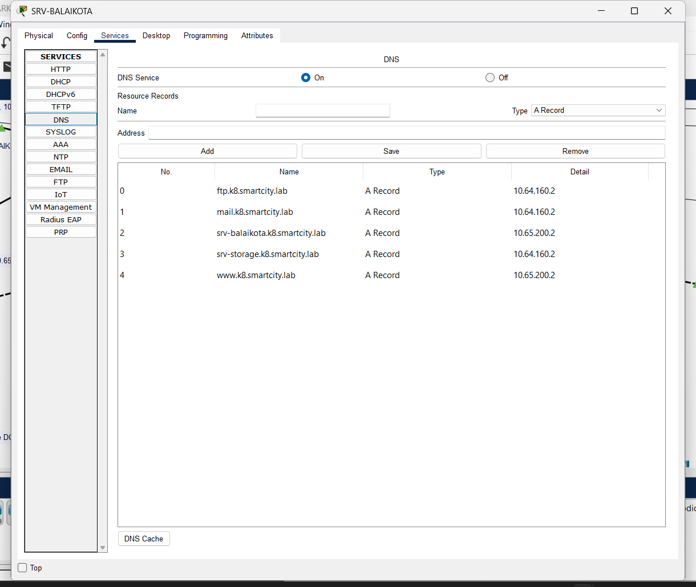

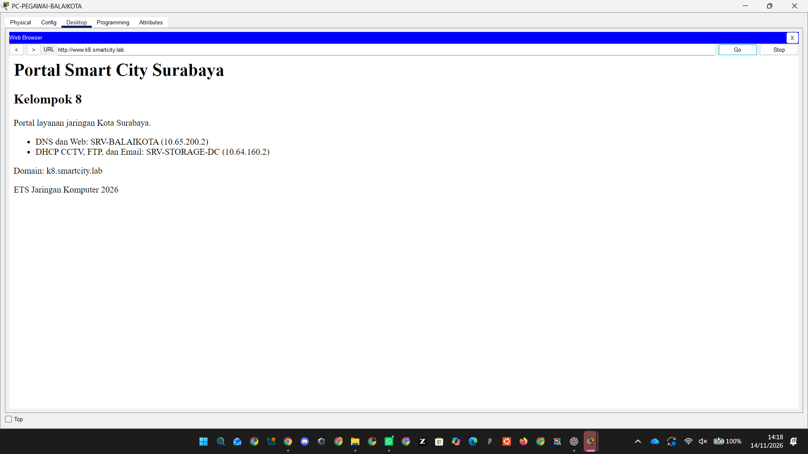

### 8.2 SRV-STORAGE-DC - DHCP CCTV, FTP, dan Email

- IP statis: `10.64.160.2/24`, gateway `10.64.160.1`, DNS `10.65.200.2`.
- DHCP CCTV melayani `10.64.128.0/19` melalui DHCP relay R-DC.
- FTP aktif dengan akun `admin-k8`; semua permission diaktifkan. Login dan perintah `dir` berhasil dari PC Balai Kota.
- Email memakai domain `k8.smartcity.lab`, akun `admin@k8.smartcity.lab` dan `petugas@k8.smartcity.lab`. Kirim dan terima email antar akun berhasil.

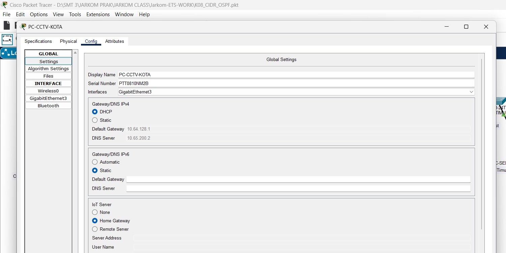

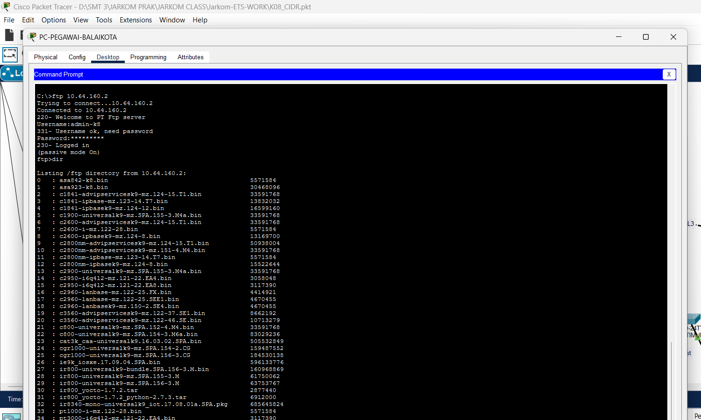

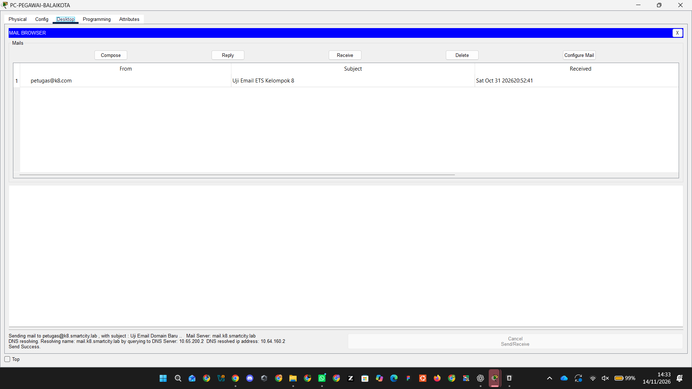

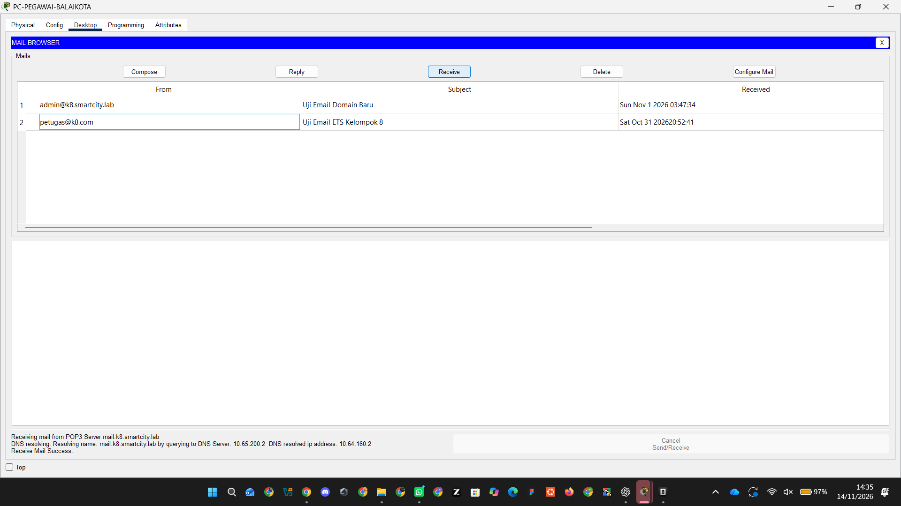

### 8.3 Hasil uji CIDR dan OSPF

#### Pengujian pada K08_CIDR.pkt

**DHCP PC Balai Kota**

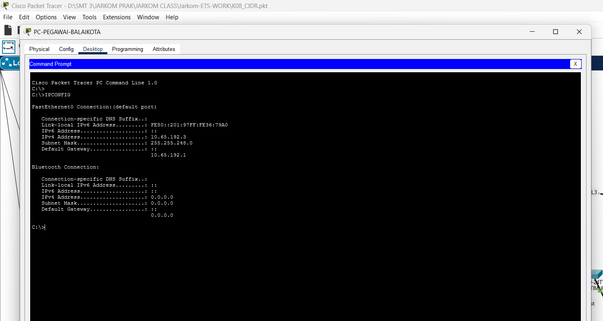

**Ping antarwilayah ke PJU Selatan**

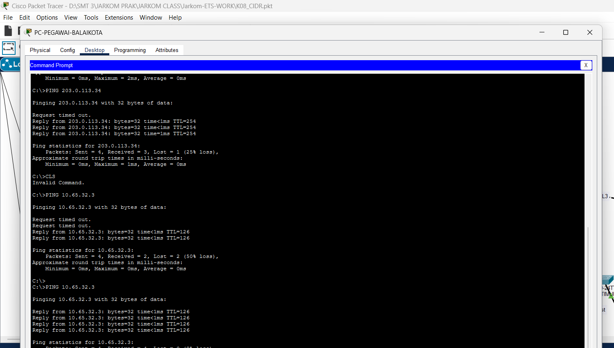

**Pool DHCP PJU menggunakan mask /25**

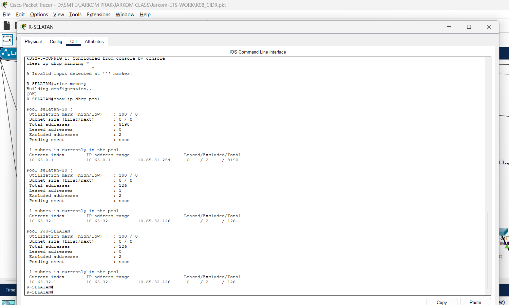

**Lease DHCP PJU menggunakan mask /25**

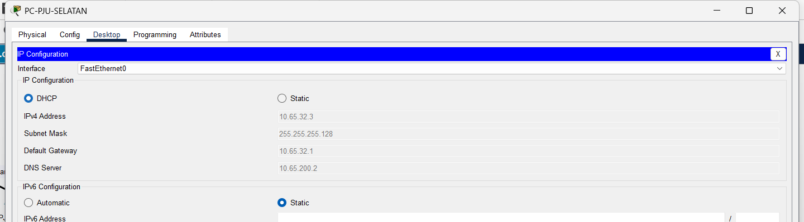

**Ping PJU Timur tanpa packet loss**

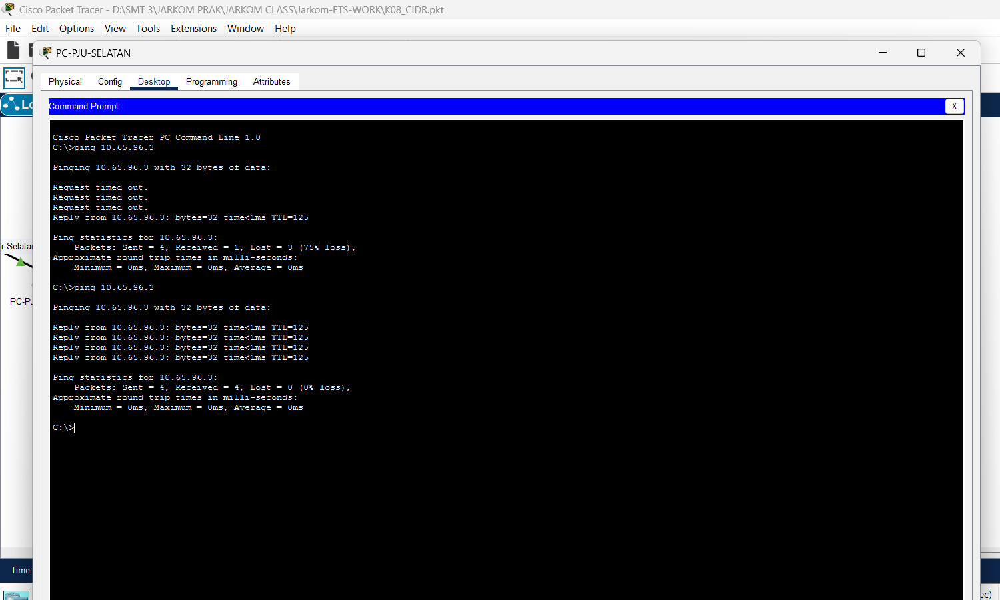

#### Pengujian pada K08_CIDR_OSPF.pkt

**DHCP PJU pada file OSPF**


**Ping ke server DNS dan Storage DC**

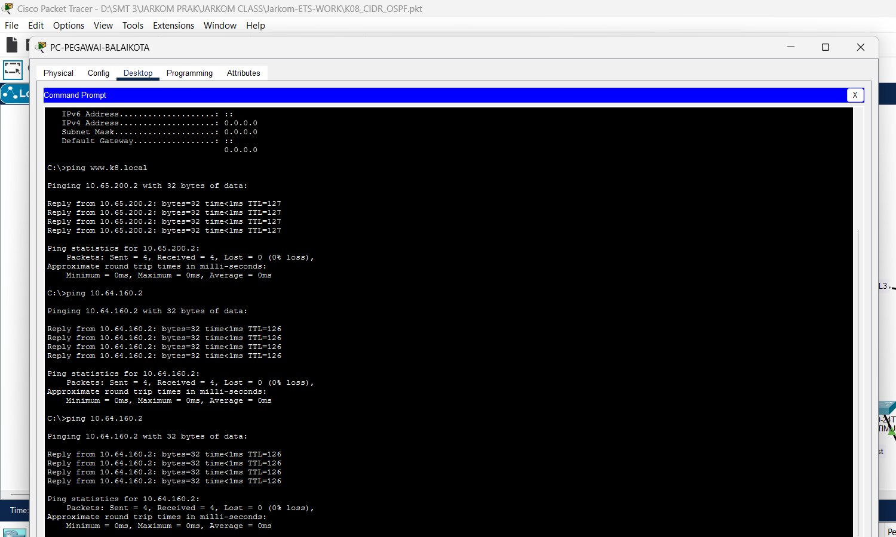

**Ping antarwilayah**

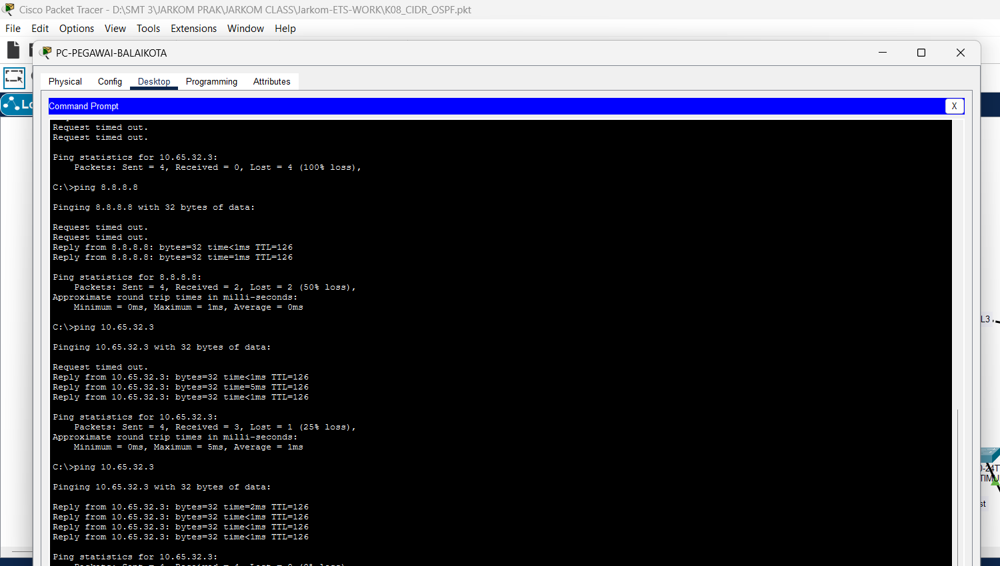

**Neighbor OSPF berstatus FULL**


**Rute hasil OSPF**


**Default route OSPF**


**R-ISP tanpa rute privat internal**


**Label WAN 203.0.113.32/30**

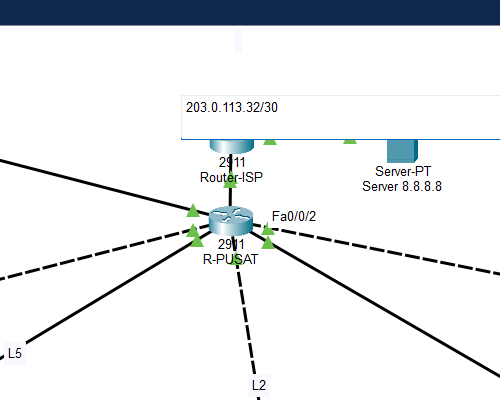

**Ping internet setelah perbaikan**

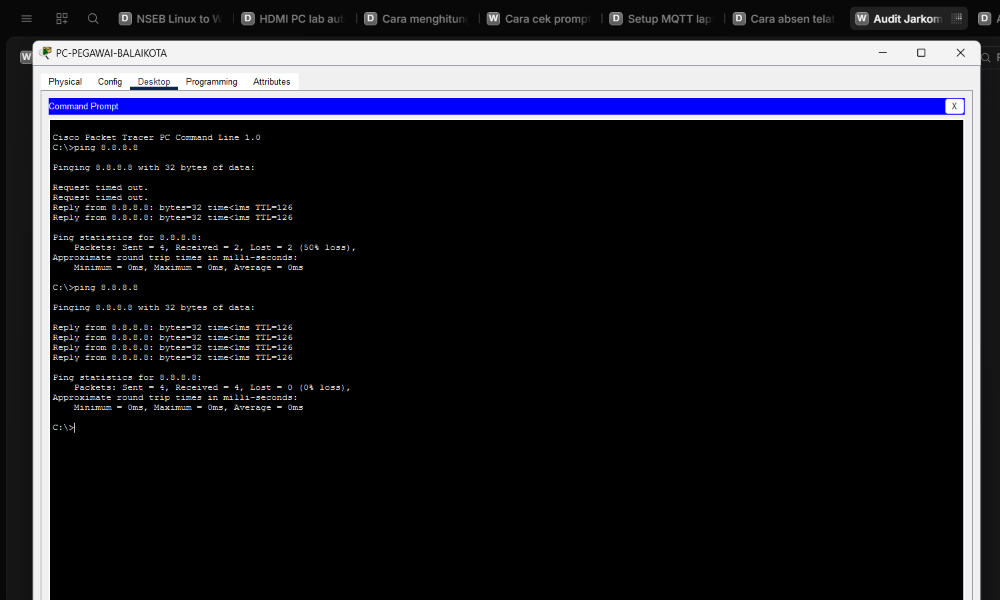

## Checklist Akhir

Status lengkap per nomor soal dan sisa pekerjaan ada di [CHECKLIST_ETS.md](./CHECKLIST_ETS.md).
